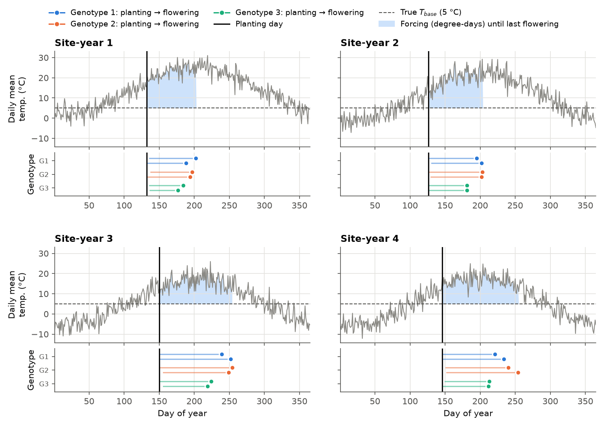
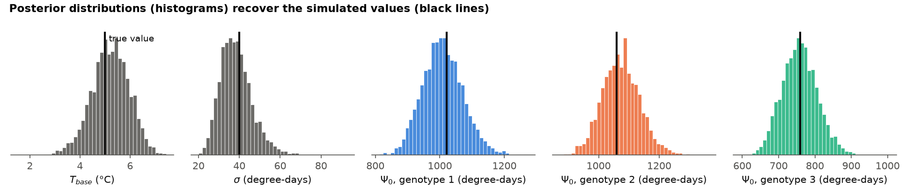
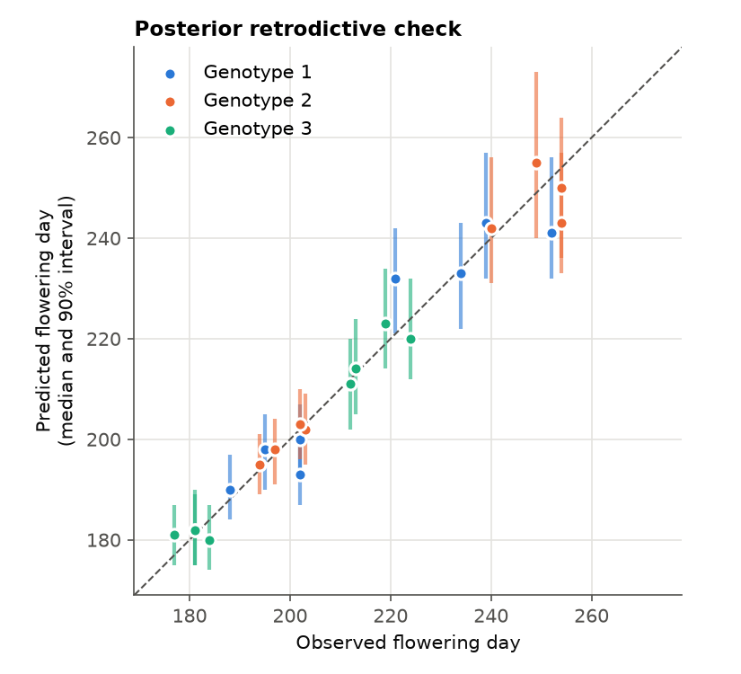
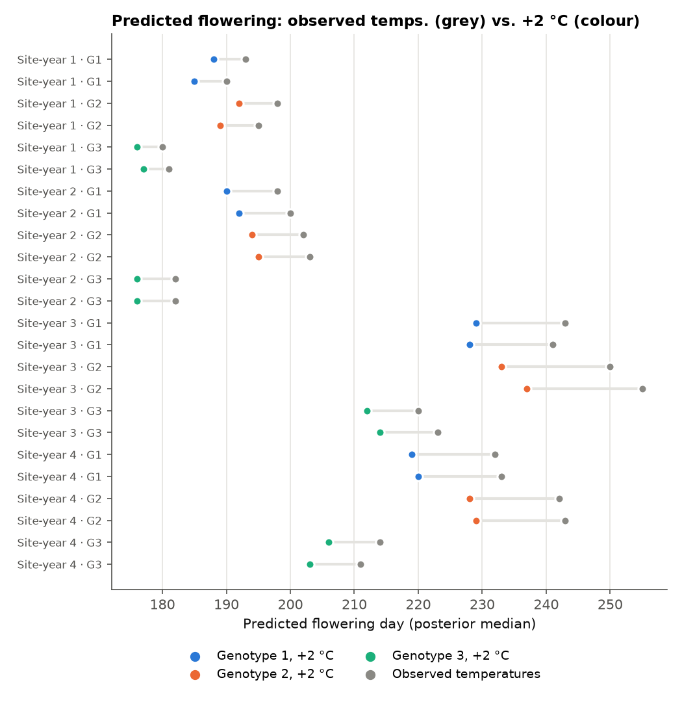

# phenosurv 

**phenosurv** is a Python interface to [phenostan](https://github.com/phenostan/phenostan), a set of Bayesian models for modeling when plants reach a phenological stage (for example flowering) from daily temperature. It lets ecologists fit those models to their own data, check the fit, conduct inference, and make predictions without writing reinventing Stan code. We also plan to develop an R interface to `phenostan`, `phenostanr`, as well as a website.

Most existing phenological modeling software in Python and R contain process models for trees (e.g. Uniforc, Sequential, etc.) and are fit with maximum likelihood or simulated annealing. Other phenological software are designed for use with remote sensing data or herbaria records. Instead, this package provides simple, reproducible access to advanced models purpose-built for field collected data including censoring, random effects, and sequential multi-stage data (e.g. emergece -> anthesis -> senescence). We plan to equip `phenostan` (and therefore `phenosurv`) with several models from recent methodological advances to address these challenges unique to phenological field observations of angiosperms, including:
- Thresholding Survival Models (Betancourt 2022) with process-based forcing kernels
  - Growing Degree Day (**This model currently available as `phenosurv.ThreshSurvGDD`**)
  - Wang & Engel (planned)
- Sequential Survival Models for multi-stage categorical phenology observations (planned)
  - Exponential hazards
  - Weibull hazards
  - Log Logistic hazards

> **Status:** work in progress (prerelease, not yet on PyPI). One model, `ThreshSurvGDD`, is available. The API is being built test-first and may change. This package started as part of a class project on software engineering for scientists. In this class, we are learning to use industry standard best practices and generative artificial intelligence (gen-A.I) tools in thoughtful ways to develop scientifc software. Review the AI-POLICY.md file to read more about our view on responsible gen-AI use in scientific software development.

### Model Overview

#### Thresholding Survival Model with GDD forcing kernel
`ThreshSurvGDD` is a *threshold survival model with growing-degree-day forcing*. From a starting day (the **precursor** event, e.g. planting), each day adds forcing `max(T − T_base, 0)` in degree-days. The event (eg flowering) happens on the day that accumulated forcing passes a threshold. The threshold varies from plant to plant: it is drawn from a logistic distribution centred on a genotype-specific requirement `Psi0[g]` with spread `sigma`, and genotype requirements share a common mean `Psi0_bar` and spread `tau_psi0`. The model estimates `T_base`, `Psi0`, `sigma` and the genotype-level parameters from observed precursor and event days. Use `ThreshSurvGDD().print_code()` to read the Stan source. The original source code, prior to modification, is from Betancourt (2022).

## Installation

`phenosurv` runs its models with [CmdStan](https://mc-stan.org/docs/cmdstan-guide/), the command-line version of the [Stan](https://mc-stan.org) language. CmdStan compiles each model to a C++ program, so it needs a C++ toolchain. Python reaches CmdStan through [cmdstanpy](https://mc-stan.org/cmdstanpy/).

### Recommended: pixi (CmdStan and compiler included)

[pixi](https://pixi.sh) installs Python, CmdStan, a C++ compiler and every other dependency at the versions pinned in `pixi.lock`. Nothing outside the project folder is changed.

```sh
# 1. Install pixi (once per computer; restart the terminal afterwards)
curl -fsSL https://pixi.sh/install.sh | sh  # macOS / Linux
# powershell -ExecutionPolicy ByPass -c "irm -useb https://pixi.sh/install.ps1 | iex"   # Windows

# 2. Get the code and build the environment (the first run takes a few minutes)
git clone https://github.com/phenostan/phenosurv.git
cd phenosurv
pixi install

# 3. Check it works
pixi run test       # test suite (a few seconds once the model is compiled)
pixi run example    # worked example below; regenerates docs/figures/
```

Use `pixi run python ...` for single commands or enter the environment with `pixi shell` before running commands to work inside the environment. For those coming from `mamba` or `conda`, `pixi shell` is similar to running `conda activate this-environment.yml`.

### Alternative: pip or conda in your own environment

`phenosurv` itself only depends on `cmdstanpy`, but **CmdStan must also be installed**. The simplest way is conda-forge, which supplies CmdStan together with its compiler:

```sh
conda install -c conda-forge cmdstanpy cmdstan     # or mamba / micromamba
pip install git+https://github.com/phenostan/phenosurv.git
```

If you use plain pip, install cmdstanpy and then CmdStan with `python -m cmdstanpy.install_cmdstan`. This needs a working C++ toolchain (Xcode Command Line Tools on macOS, `g++` and `make` on Linux, RTools on Windows). See the [cmdstanpy installation guide](https://mc-stan.org/cmdstanpy/installation.html) if compilation fails. The plotting below also needs `matplotlib`.

## Quick start

```python
from phenosurv import ThreshSurvGDD

model = ThreshSurvGDD()                          # compiles the Stan model (first time only)
model.fit("tests/data/testdata.json", seed=1)    # dict or path to a JSON file; runs 4 MCMC chains
print(model.diagnose())                          # sampler health check
model.summary()                                  # pandas DataFrame of posterior summaries
pred = model.predict(new_data, seed=2)           # (n_draws, N) array of predicted event days
```

| Method | What it does | Returns |
| --- | --- | --- |
| `print_code()` | Prints the Stan model | `None` |
| `fit(data, chains=4, iter_warmup=1000, iter_sampling=1000, **kwargs)` | Wrapper for `cmdstanpy.CmdStanModel.sample`. Draws posterior samples with NUTS. Extra arguments (`seed`, `adapt_delta`, ...) go to [`CmdStanModel.sample`](https://mc-stan.org/cmdstanpy/api.html#cmdstanpy.CmdStanModel.sample) | `self` |
| `diagnose()` | Wrapper for `cmdstanpy.CmdStanMCMC.diagnose`. Runs CmdStan's checks for divergences, tree depth, E-BFMI, R-hat and effective sample size | `str` |
| `summary()` | Wrapper for `cmdstanpy.CmdStanMCMC.summary`. Mean, MCSE, SD, quantiles, ESS and R-hat for every parameter | `pandas.DataFrame` |
| `predict(data=None, **kwargs)` | Predicts event days for new data (`events` may be omitted) or, by default, for the fitted data. Exposes the underlying [`CmdStanMCMC`](https://mc-stan.org/cmdstanpy/api.html#cmdstanpy.CmdStanMCMC) object, for use with other software like `Arviz` for diagnostics and visualization| |

Planned (see issue #2): `posterior()`, `visualize()`, `report()`.

### Data format

Data is a dict (or JSON file) in the layout the Stan program expects. Site-years have different numbers of days and events, so each kind of value is concatenated into one flat array, and `*_start_idxs` give where each site-year begins. **All indices and day numbers are 1-based**, since Stan counts from 1.

| Field | Shape | Meaning |
| --- | --- | --- |
| `N_site_years` | int | Number of site-years (one site in one year = 1) |
| `obs_temps` | `N_obs_temps` | Daily mean temperature (°C) for every site-year, concatenated |
| `N_days`, `temp_start_idxs` | `N_site_years` | Days in each site-year, and where its temperatures start in `obs_temps` |
| `N` | int | Number of events (e.g. individual plants) |
| `precursor_events`, `events` | `N` | Day of year forcing starts (e.g. planting) and the event happens (e.g. flowering). Grouped by site-year |
| `N_events`, `event_start_idxs` | `N_site_years` | Events in each site-year, and where they start in the event arrays |
| `N_geno`, `genotype` | int, `N` | Number of genotypes, and the genotype (1..`N_geno`) of each event |
| `N_temp_grid`, `temp_grid` | int, `N_temp_grid` | Temperatures at which to report the fitted forcing curve |
| `use_threading`, `grainsize` | int, int | Within-chain parallelism. Use `0` and `1` unless you have compiled with threading |

`tests/data/testdata.json` is a complete example, simulated by `scripts/simulate_testdata.py` from the known parameter values in `tests/data/testdata_truth.json`.

## Worked example

[`examples/worked_example.py`](examples/worked_example.py) fits the model to the simulated test data, checks the fit and predicts flowering under a warmer climate. Run it with `pixi run example`. Below is a condensed version; the script also makes the figures.

```python
import json
import numpy as np
from phenosurv import ThreshSurvGDD

data = json.load(open("tests/data/testdata.json"))

model = ThreshSurvGDD().fit(data, seed=1)
print(model.diagnose())
print(model.summary().loc[["T_base", "sigma", "Psi0[1]", "Psi0[2]", "Psi0[3]"]])

pred_obs = model.predict(seed=2)            # retrodict the observed events

warm = {k: v for k, v in data.items() if k != "events"}
warm["obs_temps"] = [t + 2.0 for t in data["obs_temps"]]
pred_warm = model.predict(warm, seed=3)     # new data: same sites and plantings, +2 °C
```

**The data.** Four site-years of daily temperature (top of each panel) and, below it, one row per plant: two plants of each of three genotypes, each drawn as a bar from planting (the precursor) to flowering (the event). The shaded area is the forcing the model accumulates, degrees above `T_base` each day. Flowering comes later in the cooler site-years 3 and 4, because forcing builds up more slowly there.



**Diagnostics.** `diagnose()` reports no divergent transitions, satisfactory tree depth, E-BFMI, effective sample size and R-hat ("Processing complete, no problems detected"). Some *"Scale parameter is inf"* messages appear at the start of warmup. These are normal: the sampler tries extreme values while it adapts, and cmdstanpy reports the rejected proposals.

**Parameter recovery.** Because the data were simulated, we know the true values. The posterior for each parameter contains its true value:



| Parameter | True | Posterior mean (SD) |
| --- | --- | --- |
| `T_base` (°C) | 5.0 | 5.2 (0.8) |
| `sigma` (degree-days) | 40 | 38 (8) |
| `Psi0[1]` | 1021 | 1009 (63) |
| `Psi0[2]` | 1060 | 1074 (63) |
| `Psi0[3]` | 759 | 758 (49) |

**Retrodictive check.** Predicting the data the model was fitted to shows whether it reproduces what was observed. Observed flowering days fall near the 1:1 line, and 23 of 24 lie inside their 90% predictive intervals (about 22 would be expected):



**Predicting new data.** With every day 2 °C warmer, the model predicts earlier flowering for every plant: a median of about 10 to 11 days earlier for genotypes 1 and 2, and 7 days earlier for genotype 3, which needs less forcing. Cooler site-years shift more, because a 2 °C rise is a larger fraction of their daily forcing.




## Project layout

```
src/phenosurv/thresh_surv_gdd.py   ThreshSurvGDD class (the Python API)
src/phenosurv/stan/                Stan models vendored from phenostan; do not edit (see CONTRIBUTING)
tests/                             unittest suite and simulated test data
examples/worked_example.py         the worked example above
scripts/                           test-data simulator and model sync tool
```

## Contributing and code review

Read [CONTRIBUTING.md](CONTRIBUTING.md) before reviewing or changing code. It covers the development setup, the test-first workflow the project follows, and what reviewers should look for.
